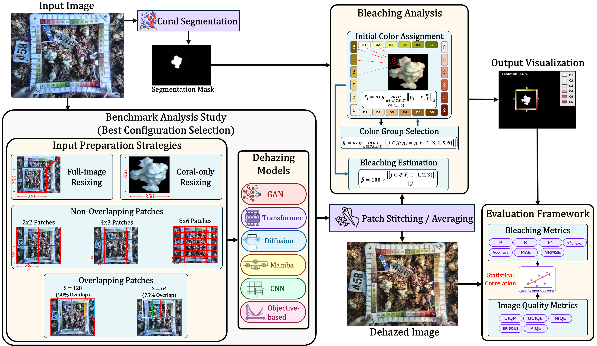
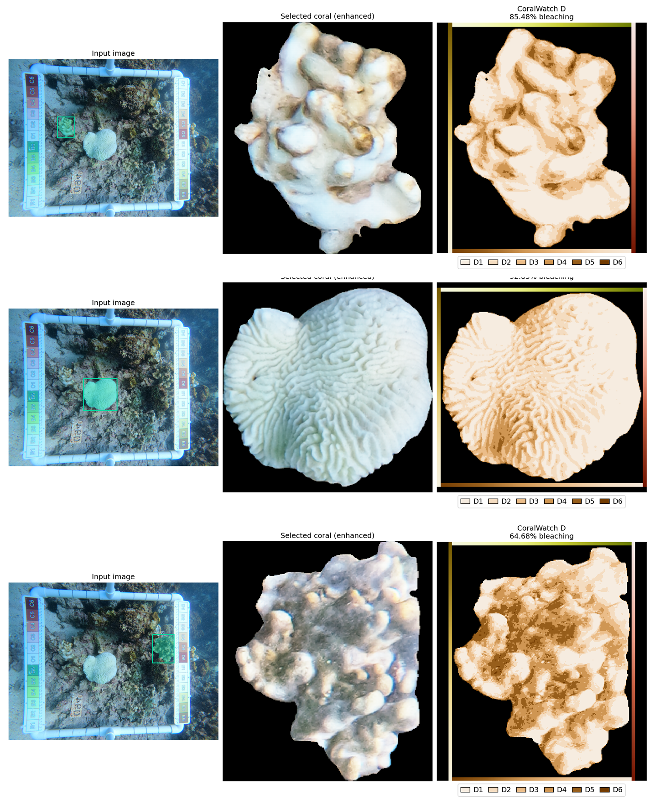
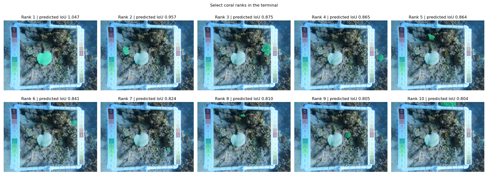

<h1 align="center">
<br>
  DigiWatch: Reframing Underwater Image Dehazing for CoralWatch-Based Coral Reef Health Inspection
</h1>
 
<h2 align="center">
Authors:</h2>
 
<div align="center">
<a href="https://scholar.google.com/citations?user=KyBKIm8AAAAJ&hl=en">Mahmoud Elmezain</a> &nbsp;•&nbsp;
<a href="https://scholar.google.com/citations?user=DCppi6gAAAAJ&hl=en">Basit Alawode</a> &nbsp;•&nbsp;
<a href="https://scholar.google.com/citations?user=2_e4vboAAAAJ&hl=en">Atif Sultan</a> &nbsp;•&nbsp;
<br/>
<a href="https://scholar.google.com/citations?hl=en&user=FEcCB9IAAAAJ">Muayad Abujabal</a> &nbsp;•&nbsp;
<a href="https://scholar.google.com/citations?user=0qKYbyAAAAAJ&hl=en">Tarek Taha</a> &nbsp;•&nbsp;
<a href="https://scholar.google.com/citations?user=6qvbEhUAAAAJ&hl=en">Sajid Javed</a> &nbsp;•&nbsp;
<a href="https://scholar.google.com/citations?user=bCC3kdUAAAAJ&hl=en">Irfan Hussain</a> &nbsp;
<br/>
</div>
 
<h4 align="center">
<a href="https://papers.ssrn.com/sol3/papers.cfm?abstract_id=7100726"><b>Paper</b></a> &nbsp;
</h4>
 
<div align="center">
 
[](https://opensource.org/licenses/MIT) &nbsp;&nbsp;&nbsp;&nbsp;   &nbsp;&nbsp; 
 
</div>
 
[cc-by-sa]: http://creativecommons.org/licenses/by-sa/4.0/
[cc-by-sa-shield]: https://img.shields.io/badge/License-CC%20BY--SA%204.0-lightgrey.svg
 
# Dataset
 
The dataset is available on Google Drive:
 
[Download the dataset](https://drive.google.com/drive/folders/1HCrwAC6WHCyENQeYQ3cYjHBm7kXVjgVU)
 
# About this project 🪸
 
Color-reference charts provide a non-invasive approach for coral bleaching assessment; however, their utility in underwater imagery is strongly affected by wavelength-dependent color attenuation, scattering, turbidity, and non-uniform illumination. Existing automated and semi-automated color-based workflows commonly rely on detecting the physical chart in the scene and extracting image-specific reference colors, which limits their applicability to images where the chart is visible alongside the coral.
 
In this work, we propose DigiWatch, a physical-chart-free CoralWatch-based benchmark pipeline for coral reef health inspection.  The proposed method directly matches segmented coral pixels to the original digital CoralWatch RGB palette after underwater image restoration, enabling pixel-level bleaching visualization and percentage-level severity estimation. To evaluate whether underwater restoration improves this downstream ecological task, we benchmark 16 state-of-the-art underwater image dehazing models across seven input-preparation strategies, including full-image resizing, coral-only resizing, non-overlapping patch grids, and overlapping patch reconstruction. Experiments are conducted on 3,400 field-collected 4K underwater coral images with expert-annotated bleaching labels.
 
## Pipeline
During benchmarking, each input image is prepared through full-image resizing, coral-only resizing, non-overlapping patching, or overlapping patching. Each prepared input is processed by one of the benchmarked dehazing models, and every combination of input-preparation strategy and dehazing model is evaluated independently as a separate experimental configuration. Patch-based outputs are stitched or averaged as required, after which the coral segmentation mask is applied for bleaching analysis. Coral colors are then assigned to the digital CoralWatch reference colors, and the resulting bleaching estimates are visualized and evaluated using task-specific metrics. Image-quality metrics are also computed for each enhanced output, and their associations with the bleaching metrics are analyzed statistically.
 
<p align="center">

</p>
 
## Automatic Mode
To run the pipeline on a single image automatically, the top-k most confident predictions from CoralSCOP are selected and analyzed:
<p align="center">

</p>
 
## Manual Mode
To run the pipeline on a single image while selecting which corals are analyzed, the top-k most confident predictions from CoralSCOP are displayed, and the user can select from them manually:
<p align="center">

</p>
 
 
 
# Running the Codes 🚀
## Installation
 
### 1. Clone the repository
```console
git clone https://github.com/MahmoudElMezain/DigiWatch.git
cd DigiWatch
```
 
### 2. Create the environment
The shared environment runs CoralSCOP and the standard enhancement adapters. SLURPP additionally needs its optional diffusion dependencies; see the [model setup guide](docs/SETUP.md).
 
```console
conda env create -f environments/environment.yml
conda activate coralwatch
```
 
Install the validated PyTorch CUDA 12.4 runtime and the remaining dependencies:
 
```console
python -m pip install torch==2.6.0 torchvision==0.21.0 --index-url https://download.pytorch.org/whl/cu124
python -m pip install -r requirements.txt
python -m pip check
```
 
For a CPU installation, replace the PyTorch installation command with:
 
```console
python -m pip install torch==2.6.0 torchvision==0.21.0 --index-url https://download.pytorch.org/whl/cpu
```
 
The [environment setup guide](docs/SETUP.md) covers Windows and Linux installation, runtime checks, and optional model dependencies. The reference configuration uses Python 3.12, PyTorch 2.6.0, and torchvision 0.21.0. A GPU is recommended for segmentation and diffusion inference.
 
### 3. Set up the selected models
Follow the instructions in the official [CoralSCOP repository](https://github.com/zhengziqiang/CoralSCOP) and your chosen [enhancement model repository](#dehazing-models-and-repositories). Use the local filenames listed in the [model file manifest](Models/weights_manifest.json), then verify your installation:
 
```console
python tools/check_weights.py --model mulagan
```
 
The [model setup guide](docs/MODELS.md) explains the required model variants and adapter settings.
 
## Automatic mode
If you want to analyze the three highest-ranked CoralSCOP predictions with MuLA-GAN:
 
```console
python "Full Pipeline.py" "path/to/image.jpg" --model mulagan --mode coral-resize --analysis-mode automatic --coral-count 3
```
 
Replace `path/to/image.jpg` with your input image. Use `--coral-count 1` for a shorter first run, or add `--device cpu` for CPU inference.
 
## Manual mode
If you want to display the top ten candidates and enter the ranks you want to analyze:
 
```console
python "Full Pipeline.py" "path/to/image.jpg" --model mulagan --analysis-mode manual --top-k 10
```
 
Enter ranks separated by commas or spaces, such as `1, 3, 5`. Manual mode analyzes every distinct selected rank. `CORAL_COUNT` applies only to automatic mode.
 
You can also provide the selected ranks directly:
 
```console
python "Full Pipeline.py" "path/to/image.jpg" --model mulagan --analysis-mode manual --selection 1 3 5 --no-show
```
 
## Configuration
To run the file from an editor, set `INPUT_IMAGE` near the top of [Full Pipeline.py](Full%20Pipeline.py). Command-line arguments override the corresponding settings.
 
```python
INPUT_IMAGE = "path/to/image.jpg"  # Input image name or path.
PREPARATION_STRATEGY = "coral-resize"  # full-resize, coral-resize, patches, overlap.
PATCH_SIZE = 256  # Source patch size; model inputs are resized to 256.
PATCH_GRID = None  # (columns, rows), e.g. (2, 2), (4, 3), or (8, 6).
PATCH_STRIDE = 128  # Overlap stride in source pixels.
DEHAZING_MODEL = "mulagan"  # Model name from the repository table.
ANALYSIS_MODE = "automatic"  # automatic or manual.
TOP_K = 10  # Number of ranked CoralSCOP candidates.
CORAL_COUNT = 3  # Number of corals in automatic mode.
SELECTED_CORALS = ()  # Manual ranks; empty prompts for selection.
```
 
Set `DEHAZING_MODEL` to your chosen model, or use `--model` when running from the command line. Set `OUTPUT_DIR` to choose where result folders are saved.
 
### Image preparation
- **`full-resize`:** Resize the entire photograph to 256 × 256 before enhancement.
- **`coral-resize`:** Crop the enclosing square of each selected coral and resize it to 256 × 256. Add `--coral-background` to retain the crop background.
- **`patches`:** Enhance non-overlapping patches, then reconstruct the image at its original dimensions.
- **`overlap`:** Enhance overlapping patches, average the overlapping regions, then reconstruct the image at its original dimensions.
 
```console
python "Full Pipeline.py" "path/to/image.jpg" --model mulagan --mode patches --grid 2 2
python "Full Pipeline.py" "path/to/image.jpg" --model mulagan --mode patches --grid 4 3
python "Full Pipeline.py" "path/to/image.jpg" --model mulagan --mode patches --grid 8 6
python "Full Pipeline.py" "path/to/image.jpg" --model mulagan --mode overlap --patch-size 256 --stride 64
```
 
`PATCH_GRID` accepts any pair of positive integers in `(columns, rows)` order. The examples produce 4, 12, and 48 patches. A fixed grid first resizes the photograph to fit that grid; `PATCH_GRID = None` instead covers the native image and pads its edges as needed.
 
`PATCH_SIZE` is a positive integer measured in source pixels. Every patch is resized to 256 × 256 for the model, then resized back before stitching. For overlapping patches, `PATCH_STRIDE` can be any integer from 1 to `PATCH_SIZE - 1`. Smaller strides produce more patches for native-image coverage. These settings control model input preparation; saved figure dimensions are controlled separately by the visualization code.
 
### Color matching
 
The fixed B/C/D/E CoralWatch palette contains six shades per series. Initial matching selects the dominant series using grades 3–6, then assigns samples to that series' six shades. The bleaching percentage is the proportion assigned to grades 1–3.
 
The default `--color-sampling legacy-grid` averages foreground colors over a regular square grid. Use `--color-sampling pixels` to classify individual foreground pixels. Select `--distance rgb_euclidean`, `cielab_euclidean`, or `ciede2000`. Lab distances use the legacy conversion by default; `--lab-conversion srgb` selects the standard sRGB conversion.
 
### Output
 
Each run creates a folder under `Output/` containing one PNG figure per analyzed coral. Automatic mode with three selected predictions produces three figures; manual mode with five selected predictions produces five. Each figure contains the input photograph, enhanced selected coral, and bleaching visualization, without an image-name, model, or preparation-strategy heading.
 
## Dehazing models and repositories
 
The pipeline provides **16 verified enhancement adapters**. Availability and model settings are recorded in [Models/registry.json](Models/registry.json). Use a model name from the table below with `--model`; spelling is case-insensitive and hyphens are optional. Other model names return “not available in the current pipeline.”
 
All 16 enhancement repositories are listed together below. Follow each repository's installation instructions and the [model guide](docs/MODELS.md).
 
| Model | Official repository |
| --- | --- |
| WaterMamba | [Guan-MS/WaterMamba](https://github.com/Guan-MS/WaterMamba) |
| D2Mamba | [Alik033/D2Mamba](https://github.com/Alik033/D2Mamba) |
| Phaseformer | [Mdraqibkhan/Phaseformer](https://github.com/Mdraqibkhan/Phaseformer) |
| WF-Diff | [ChenzhaoNju/WF-Diff](https://github.com/ChenzhaoNju/WF-Diff) |
| SLURPP | [kongdai123/SLURPP](https://github.com/kongdai123/SLURPP) |
| DCD-UIE | [zy-world/DCD-UIE](https://github.com/zy-world/DCD-UIE) |
| CLIP-UIE | [OUCVisionGroup/CLIP-UIE](https://github.com/OUCVisionGroup/CLIP-UIE) |
| DGD-cGAN | [SalPGS/DGD-cGAN](https://github.com/SalPGS/DGD-cGAN) |
| MuLA-GAN | [AhsanBaidar/MuLA_GAN](https://github.com/AhsanBaidar/MuLA_GAN) |
| PyUIE | [ttttllt/PyUIE](https://github.com/ttttllt/PyUIE) |
| UVE-Net | [yzbouc/UVEB](https://github.com/yzbouc/UVEB) |
| CCL-Net | [lewis081/CCL-Net](https://github.com/lewis081/CCL-Net) |
| Semi-UIR | [Huang-ShiRui/Semi-UIR](https://github.com/Huang-ShiRui/Semi-UIR) |
| PSPL | [lewis081/PSPL](https://github.com/lewis081/PSPL) |
| UIERL | [Underwater-Lab-SHU/UIERL](https://github.com/Underwater-Lab-SHU/UIERL) |
| HSRUIE | [gemyumeng/HSRUIE](https://github.com/gemyumeng/HSRUIE) |
 
DCD-UIE and CLIP-UIE default to 2,000 diffusion steps. WF-Diff retains its official fixed 10-step DDIM sampler over a 2,000-step training schedule. Patch grids increase the number of model inputs, so diffusion models can take substantially longer. Changing `--diffusion-steps` also changes the sampling schedule and results.
 
# Project Structure
 
```text
DigiWatch/
├── README.md
├── Full Pipeline.py
├── Image Dehazer.py
├── Image Patcher.py
├── Image Stitcher.py
├── Color Matcher.py
├── requirements.txt
├── Models/
├── environments/
│   └── environment.yml
├── docs/
│   ├── SETUP.md
│   └── MODELS.md
├── tools/
│   └── check_weights.py
└── Media/
    ├── Automatic.png
    ├── Manual.png
    └── Overview.png
```
 
Original DigiWatch pipeline code is released under the [MIT license](LICENSE); bundled model code retains its authors' licenses.

Coral segmentation uses [CoralSCOP](https://github.com/zhengziqiang/CoralSCOP) and its modified Segment Anything architecture. Cite the original model authors when using their work. Original source notices and license texts remain in the corresponding model folders.
 
## Bibtex 📚
```
@misc{elmezain2026digiwatch,
  title = {DigiWatch: Reframing Underwater Image Dehazing for CoralWatch-Based Coral Reef Health Inspection},
  author = {Elmezain, Mahmoud and Alawode, Basit and Sultan, Atif and Abujabal, Muayad and Taha, Tarek and Javed, Sajid and Hussain, Irfan},
  year = {2026},
  doi = {10.2139/ssrn.7100726},
  url = {https://doi.org/10.2139/ssrn.7100726},
  note = {SSRN preprint}
}
```
